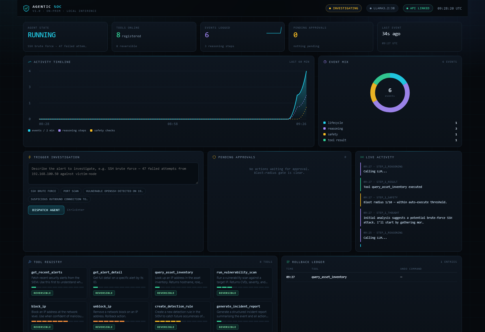

# Agentic SOC


An LLM agent that investigates security alerts, gates risky actions behind
blast-radius approval, and records an undo command for everything it does.

**It runs on your machine, against your own model. Nothing leaves the host.**

Most "autonomous SOC" demos optimise for looking impressive. This one is built
around a harder question: when the model is wrong, or talked into something by a
crafted alert, what stops it and who finds out? Three things do:

| Control | Behaviour |
|---|---|
| **Blast radius** | every tool declares 1-10; low-risk calls run immediately |
| **Approval gate** | radius >= 7 queues for a human, with the exact parameters |
| **Rollback ledger** | every executed action records an undo command |

Irreversible actions at or above the threshold are refused outright - there is no
override path in the code.



---

## Quick start

```powershell
git clone https://github.com/rainykarthick-crypto/agentic-soc.git
cd agentic-soc
.\scripts\setup.ps1 -Build -Up -Verify
```

Then open <http://127.0.0.1:3010>.

On Linux/macOS: `./scripts/setup.sh --build --up --verify`.

`setup` clones the agent, applies three small patches (explained in
[Configuration](#configuration)), builds both images and starts them.

### It needs a model

The agent calls Ollama. By default it reuses one already listening on the host:

```powershell
# if you have no model yet
docker exec <your-ollama-container> ollama pull llama3.2:3b
```

Or let this project run its own:

```powershell
docker compose --profile llm up -d
docker exec soc-ollama ollama pull llama3.2:3b
# then set OLLAMA_URL=http://ollama:11434/api/generate in .env and re-run: docker compose up -d
```

## What runs

| Component | Reached at | Role |
|---|---|---|
| Console | <http://127.0.0.1:3010> | live telemetry, approvals, ledger |
| Agent API | `127.0.0.1:8020` | `/investigate`, `/status`, `/tools`, ... |
| Ollama (optional) | `127.0.0.1:11435` | only with `--profile llm` |

Both ports bind to `127.0.0.1`. Nothing is reachable from the LAN.

## How it works

```
  alert text
      |
      v
  +-------------------- soc-agent ---------------------+
  |  ReAct loop, max 10 steps                          |
  |    reason -> pick a tool -> SAFETY GATE -> act     |
  |                                  |                 |
  |      radius < 7  ----------------+--> auto-execute |
  |      radius >= 7 ----------------+--> approval     |
  |      irreversible & >= 7 --------+--> blocked      |
  |                                                    |
  |  rollback ledger  <-- every executed action        |
  +------------------------+---------------------------+
                           |
                           v
     console (nginx :3010) --/api--> soc-agent:8000
```

Three things make it a *governed* agent rather than an autonomous one:

1. **Blast radius.** Every tool declares 1-10. Low-risk calls run immediately.
2. **Approval gate.** Anything at or above 7 waits for a human; the console shows
   the exact parameters and the reversibility of the action.
3. **Rollback ledger.** Each executed action appends its parameters and (where the
   tool provides one) an undo command, so a change can be reversed.

Irreversible actions at or above the threshold are refused outright -
there is no "override" path in the code.

## Configuration

`.env` holds one setting:

```ini
OLLAMA_URL=http://host.docker.internal:11434/api/generate   # reuse a host model
# OLLAMA_URL=http://ollama:11434/api/generate               # use the bundled one
```

`setup` applies three patches to the cloned agent (never to this repository -
upstream ships no license file, so its source is not redistributed here):

| Patch | Why |
|---|---|
| `httpx` timeout 60s -> 900s | One reasoning reply needs 150s+ on a small CPU; at the original 60s the run died at step 1 with `ReadTimeout` |
| `OLLAMA_URL` read from the environment | So the agent can share an existing model server instead of forcing a second one |
| `import os` | Required by the patch above |

All three are idempotent: re-running `setup` does nothing if they are already in
place.

## Blast radius at a glance

The tool registry is visible in the console, with a meter per tool. The bundled
registry looks like this:

| Tool | Radius | Reversible |
|---|---|---|
| `get_recent_alerts`, `get_alert_detail`, `query_asset_inventory`, `generate_incident_report` | 1 | yes |
| `run_vulnerability_scan` | 3 | yes |
| `create_detection_rule` | 5 | yes |
| `unblock_ip` | 6 | yes |
| `block_ip` | 7 | yes |

## Layout

```
agentic-soc/
|-- docker-compose.yml        agent + console (+ optional model server)
|-- .env.example              copy to .env
|-- scripts/
|   |-- setup.ps1 / setup.sh  preflight, clone, patch, build, start
|   `-- verify.ps1 / verify.sh  PASS/FAIL checks
|-- services/dashboard/       the console (static page + nginx /api proxy)
|-- docs/
|   |-- ARCHITECTURE.md       the loop, the tools, the API, the proxy
|   |-- OPERATIONS.md         commands, troubleshooting, model notes
|   |-- SECURITY.md           what the gate does and does not protect
|   `-- dashboard.png         the console, as it runs
`-- vendor/                   cloned on demand (not committed)
```

## Verification

```powershell
.\scripts\verify.ps1
```

Checks that both containers run, `/health` answers with a model name, the console
serves the dashboard, `/api` proxies to the agent, the tool registry is reachable,
both patches are present in the running container, and every published port is
loopback-only.

## Limitations

- **The agent API has no authentication.** It is loopback-only by design; do not
  publish it or put it behind a shared host without adding auth. See
  [docs/SECURITY.md](docs/SECURITY.md).
- **Investigations are slow on modest hardware.** At ~2 tokens/sec a multi-step run
  takes minutes. This is model throughput, not the agent.
- **The tools are simulated.** `get_recent_alerts` and friends read sample data in
  `tools.py`; wire them to a real SIEM/EDR before trusting the output.
- **Partial persistence.** Agent memory is written to `episodes.json` on a volume,
  so it survives restarts. The ledger and the approval queue are in-process lists
  and are lost when the agent restarts.

## Relationship to the parent project

This project was extracted from a larger private lab project, which runs the same agent and
console alongside a model, graph memory and network tooling. The two are independent: this
one stands alone, and the parent keeps its own embedded copy. The console UI is shared in
spirit - if you change one, mirror the other.

## License

MIT - see [LICENSE](LICENSE). The upstream agent source is cloned at setup time and is not
redistributed here, because it ships without a license file.
